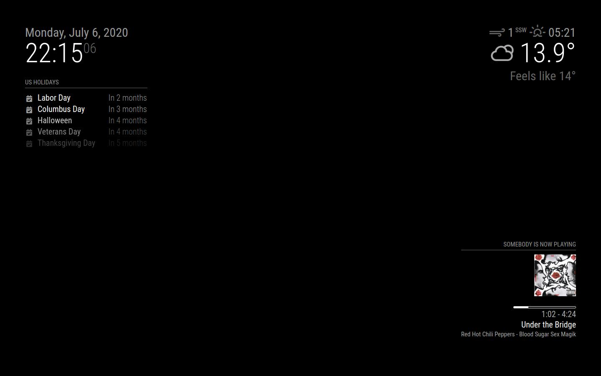

# MMM-ShairportMetadata
A module to integrate AirPlay metadata coming via <a href="https://github.com/mikebrady/shairport-sync">`shairport-sync`</a> into the <a href="https://github.com/MagicMirrorOrg/MagicMirror">MagicMirror</a>. This plugin does not work with video streaming or screen mirroring.

## Preview


## Installation
``` sh
cd ~/MagicMirror/modules
git clone https://github.com/surekap/MMM-ShairportMetadata.git
cd MMM-ShairportMetadata
npm install
```

`npm install` is only needed for AirPlay 2 now-playing information and for MQTT (`bplist-parser`, `mqtt`). The default setup, reading shairport-sync's pipe, has no dependencies. Python is no longer used.

## Using the module
Add `MMM-ShairportMetadata` module to the `modules` array in the `config/config.js` file:
``` javascript
modules: [
  {
    module: 'MMM-ShairportMetadata',
    position: 'bottom_left',
    header: 'Now playing',
    config: {
      metadataPipe: "/tmp/shairport-sync-metadata", // location of pipe with shairport-sync metadata
      alignment: "center",  // Possible values [left|right|center]. Default: center
    }
  },
]
```

| Option | Default | |
|---|---|---|
| `transport` | `"pipe"` | Where the metadata comes from: `"pipe"` or `"mqtt"` |
| `metadataPipe` | `"/tmp/shairport-sync-metadata"` | `transport: "pipe"`: the `pipe_name` of shairport-sync |
| `mqttUrl` | `"mqtt://localhost:1883"` | `transport: "mqtt"`: the broker shairport-sync publishes to |
| `mqttTopic` | `"shairport"` | `transport: "mqtt"`: the `topic` set in shairport-sync's `mqtt` section |
| `alignment` | `"center"` | `"left"`, `"center"` or `"right"` |
| `hideAfter` | `0` | Seconds a track may stay paused before the module hides; `0` hides it only when the playback ends or the sender disconnects |
| `sampleRate` | `44100` | Frames per second of the progress that classic AirPlay reports |

### The header
The header is MagicMirror's own: set `header` on the module, or leave it out. The module never changes it. While nothing is playing the whole module, header included, is hidden, and it shows again when playback starts. (Earlier versions set the header themselves, and a `header: ""` was needed to stop the flicker; that is no longer necessary.)

## Integration with shairport-sync
### Pipe (default)
Example configuration for `shairport-sync`:
``` javascript
metadata =
{
		enabled = "yes"; // set to yes to get Shairport Sync to solicit metadata from the source and to pass it on via a pipe
		include_cover_art = "yes"; // set to "yes" to get Shairport Sync to solicit cover art from the source and pass it via the pipe. You must also set "enabled" to "yes".
		pipe_name = "/tmp/shairport-sync-metadata";
		pipe_timeout = 5000; // wait for this number of milliseconds for a blocked pipe to unblock before giving up
//      socket_address = "226.0.0.1"; // if set to a host name or IP address, UDP packets containing metadata will be sent to this address. May be a multicast address. "socket-port" must be non-zero and "enabled" must be set to yes"
//      socket_port = 5555; // if socket_address is set, the port to send UDP packets to
//      socket_msglength = 65000; // the maximum packet size for any UDP metadata. This will be clipped to be between 500 or 65000. The default is 500.
};

```
The pipe is a Unix named pipe (Linux, macOS); where there is none, use MQTT. The user that runs MagicMirror must be able to read the pipe. If shairport-sync is not running yet, or restarts, the module waits for it and reconnects by itself, backing off from 1 to 30 seconds; the log line `reading /tmp/shairport-sync-metadata` says when it is connected.

### MQTT
shairport-sync must be built with MQTT support (`--with-mqtt-client`; `shairport-sync -V` lists `mqtt`), and the module needs `npm install`. You also need a broker, for example Mosquitto. In shairport-sync's configuration:
```
mqtt =
{
	enabled = "yes";
	hostname = "localhost";
	port = 1883;
	topic = "shairport";
	publish_raw = "yes";    // the module only uses the raw topics
};
```
and in the module's config `transport: "mqtt"`, with `mqttUrl` and `mqttTopic` to match.

### AirPlay 2
Builds of shairport-sync with AirPlay 2 support (`--with-airplay-2`) can also publish their metadata. For senders such as Apple Music the module reads the "now playing" information they send (title, artist, album, artwork, duration and the exact position, so pauses and seeks are followed); other senders are read through the classic tags, as before. This support, ported from pull request #21, has so far been tested against synthetic data only; if it misbehaves for you, please open an issue with a capture (see below).

## Troubleshooting
Check that the module is connected (`reading ...` or `connected to ...` in MagicMirror's log), then look at what shairport-sync really sends. With MagicMirror stopped (only one reader gets each item from the pipe):
``` sh
timeout 30 cat /tmp/shairport-sync-metadata > capture.raw    # play something meanwhile
node test/replay.js capture.raw                               # in the module's folder
```
`replay.js` prints what the module would show after each item, and a tally of the items it saw. For MQTT: `mosquitto_sub -t 'shairport/#' -F '%U %t %x' > session.txt` and `node test/replay.js --mqtt session.txt`. When you report a problem, the issue form asks for these details.

## Development
No hardware is needed: the tests feed the parser, the state, a real named pipe, a real MQTT broker (in process) and the front-end (in Chromium) with data built by `test/helpers.js`.
``` sh
npm install
npx playwright install chromium   # for the front-end tests
npm test
MAGICMIRROR_DIR=/path/to/MagicMirror npm run test:magicmirror   # the module inside a real MagicMirror
```
A capture from a real sender is worth more than any fixture: attach one to an issue, or add it as a test.

## Credits
By Prateek Sureka. The progress bar is by ChielChiel. The playback position as an anchor, and the parsing of AirPlay 2 now-playing information, are from pull request #21 by Dnovak043.
